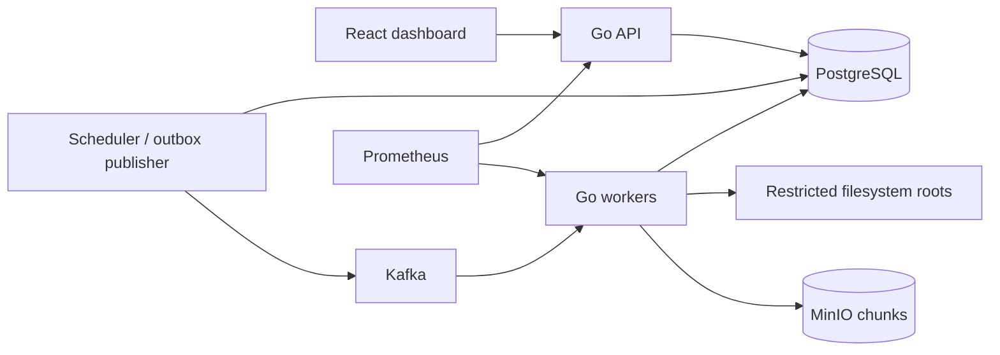
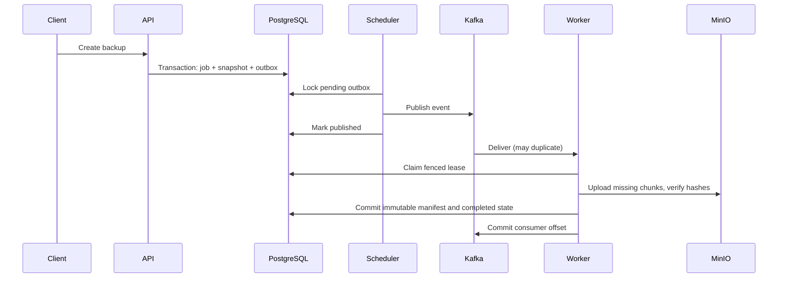

# Architecture

The control plane consists of the HTTP API and scheduler. The data plane consists
of independently scalable workers. Shared source and restore mounts must have the
same contents and paths on all workers. No cloud source connector is implied.

Jobs and outbox events commit together. Publication is at least once. A worker
claims a database lease with a fresh fencing token; heartbeat renewals and final
transactions check that token. A stale worker cannot publish a snapshot. The
scheduler requeues expired leases. Restore writes also require filesystem conflict
handling; external side effects are not exactly once.

Chunk upload and garbage collection use a common PostgreSQL advisory lock. Backups
hold a shared lock through manifest commit; collection holds its exclusive form.
Per-hash transaction locks serialize identical uploads. Uploads are read back and
hashed before metadata becomes authoritative. Failed uploads may leave objects;
collection reconciles unreferenced objects while excluding active backups.

Manifests are complete snapshots, including incremental backups. Incrementals hash
all current files, reuse content-addressed chunks, record the prior recovery point,
and naturally omit deleted paths. Live filesystem scans are not an atomic filesystem
snapshot: file changes during reads are rejected where detected; use a filesystem
snapshot or quiesce writers for application-consistent backups.

