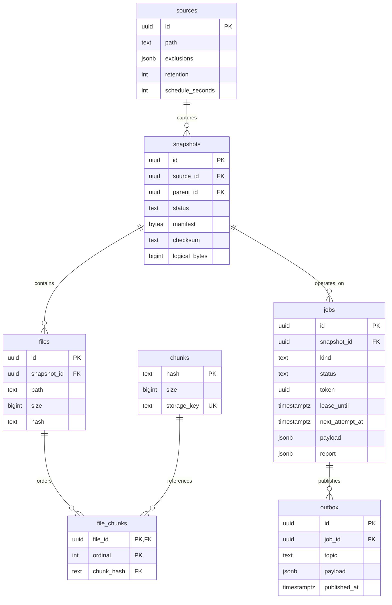

# PostgreSQL schema

`migrations/001_initial.sql` is applied once under a migration advisory lock and an
explicit transaction. `schema_migrations` tracks the version. Normal operations use
READ COMMITTED with row locks and advisory locks for the documented invariants.

Additional tables: `workers` (heartbeat registry), `audit_logs` (sensitive operation
history). There are no users because the implementation is single-operator.

Foreign keys prevent deleting referenced chunks. `(snapshot_id,path)` is unique;
`(file_id,ordinal)` preserves order. Completed snapshots require non-null manifest,
checksum and completion time. Parent deletion clears the relational parent pointer;
the original parent ID remains in the child's immutable manifest for provenance.

The application database identity must not be exposed to end users. Direct SQL can
bypass application-level lifecycle rules; limit operational access and back up the
database independently. API deletes record audit entries and use reference-safe GC.
